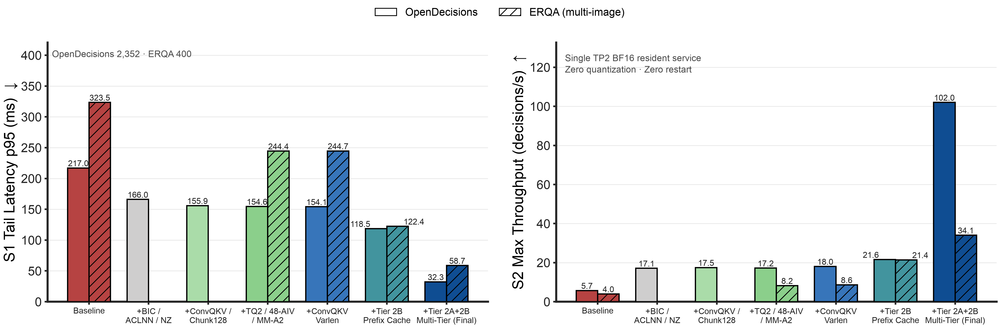
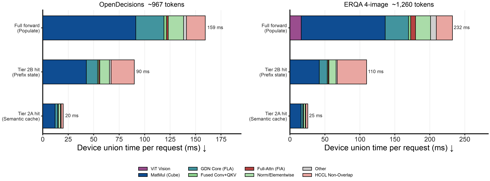
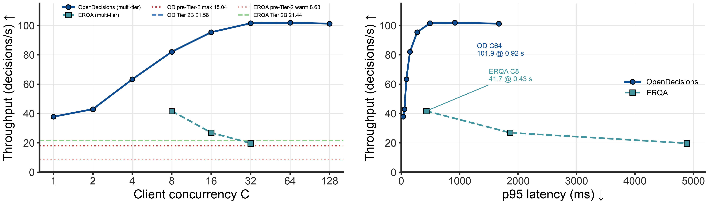
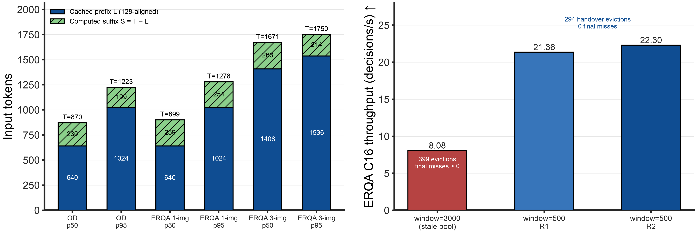
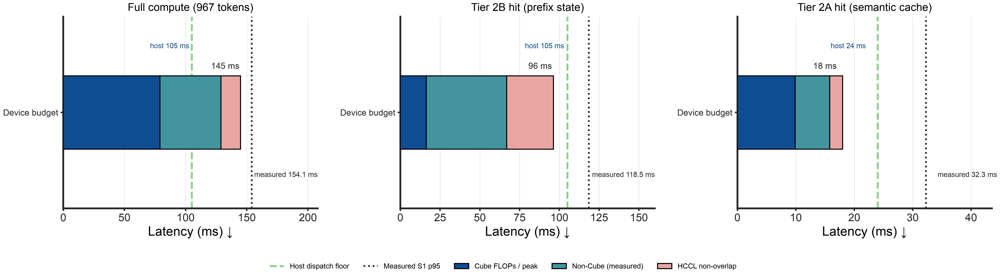

# Clef-27B-ascend

27.5B 多模态结构化决策模型 `Cloudflare/clef` 在昇腾 910A3 单物理卡双逻辑 NPU 上的全栈适配与纯 BF16 非量化推理系统工程。

本仓库通过单一常驻 TP2 服务进程，在不启用任何权重量化、不重启服务、不按请求路由多套实例的前提下，统一承载纯文本 `OpenDecisions` 与多模态图文 `ERQA` 的质量评测、S1 单并发低延迟评测及 S2 高并发吞吐评测。借鉴 Mooncake、Marconi 与 CacheBlend 等前沿存算解耦缓存思想，系统构建了主机-设备异步协同的三级异构缓存架构：Tier 1 驻留高分辨率多图视觉编码特征，Tier 2A 提供全上下文语义表征池与高层上下文精化融合，Tier 2B 维护 GDN 混合循环状态与 KV 前缀池以承接动态新问题续算。

## 核心指标

S1 取排除首轮预热后的正式 3 轮均值，S2 取最大吞吐并发点的正式 3 次均值，全程 0 失败、0 重试：

| 数据集 | 方案 | 启动方式 | S1 P95 ↓ | S2 最大吞吐 ↑ |
| --- | --- | --- | ---: | ---: |
| **OpenDecisions** | **主要采用：Tier 2A+2B 多级协同缓存** | `bash start.sh` | **32.27 ms** | **102.03 dec/s** |
| | **备用方案：纯 Tier 2B 混合前缀缓存** | `CLEF_TIER2A=0 bash start.sh` | **118.54 ms** | **21.58 dec/s** |
| | 无缓存算子优化主线 | `--prefix-state-cache off` | 154.11 ms | 18.04 dec/s |
| | 初始适配记录 | 初始单序列配置 | 217.04 ms | 5.72 dec/s |
| **ERQA** | **主要采用：Tier 2A+2B 多级协同缓存** | `bash start.sh` | **58.70 ms** | **34.06 dec/s** |
| | **备用方案：纯 Tier 2B 混合前缀缓存** | `CLEF_TIER2A=0 bash start.sh` | **122.37 ms** | **21.44 dec/s** |
| | 无缓存算子优化主线 | `--prefix-state-cache off` | 244.66 ms | 8.63 dec/s |
| | 初始适配记录 | 初始单序列配置 | 323.48 ms | 3.96 dec/s |

- **自适应级联与一键切换**：默认启动下，重复上下文命中 Tier 2A 高速路径，共享 `STATE` 或图像但更换新 `SCHEMA` 的动态请求在同一进程内自动级联至 Tier 2B；显式设置 `CLEF_TIER2A=0` 可一键固定为纯 Tier 2B 模式并自动恢复每卡 32 GiB 状态池配额。
- **精度与合规**：全程采用纯 BF16 精度与原始未校准输出，OpenDecisions 与 ERQA 各项质量指标对齐官方公开参考并稳定在 2PP 允许范围内。

## 项目结构

```text
Clef-27B-ascend/
├── start.sh                     # 官方提交启动入口
├── inference.py                 # 服务编排、SHA-256 补丁校验与内存自适应策略
├── metrics.csv                  # 质量指标汇总表
├── results.csv                  # 性能指标汇总表
├── optimization.md              # 瓶颈分析、工业级多级缓存架构与消融报告
├── result.png                   # 服务启动、硬件状态与压测运行截图
├── npu_device_call.png          # 昇腾 NPU 设备调用实测截图
├── requirements.txt             # Python 依赖锁文件
├── src/
│   ├── ascendc/                 # 自定义 Ascend C 融合算子源码与预编译包
│   ├── patches/                 # vLLM 与 vLLM-Ascend 固定版本构建补丁
│   └── runtime/                 # 运行时补丁安装器、多级异构缓存引擎与评测工具
├── scripts/
│   ├── setup_env.sh             # 一键构建项目内自包含 .venv
│   ├── activate_env.sh          # 激活 CANN / ATB 与项目虚拟环境
│   ├── download_model.sh        # 下载并校验 Cloudflare/clef 模型权重
│   ├── benchmark_systemone.py   # /v1/systemone 压测与协议校验脚本
│   ├── profile_systemone.py     # 双卡 torch_npu Profiler 采集入口
│   └── official_eval/           # OpenDecisions 与 ERQA 官方协议评测脚本
├── logs/
│   └── final-eval/              # 主方案与纯 Tier 2B 备用方案原始评测产物及校验清单
├── docs/                        # 各阶段优化专题报告与基线记录
└── imgs/                        # 消融、算子拆解、并发帕累托与 Roofline 图表
```

## 质量指标

OpenDecisions 官方参考取自 [作者公开榜单](https://huggingface.co/datasets/jgeuter/OpenDecisions#leaderboard-october-15-2026) 原始未校准输出；ERQA 使用官方 400 题标准评测集：

| 数据集 | 质量指标 | 官方公开参考 | 昇腾适配基线 | 备用方案 Tier 2B | 主要采用 Tier 2A+2B |
| --- | --- | ---: | ---: | ---: | ---: |
| OpenDecisions | Calibration | 82.3 | 82.7941 | 82.4292 | **82.4113** |
| OpenDecisions | Intelligence | 65.8 | 66.0568 | 66.0880 | **66.0841** |
| OpenDecisions | Capability | 74.1 | 74.4255 | 74.2563 | **74.2477** |
| OpenDecisions | Accuracy | — | 0.8104 | 0.8095 | **0.8095** |
| OpenDecisions | Score MAE | — | 0.401389 | 0.402579 | **0.402612** |
| ERQA | 总体 Accuracy | — | 0.5475 | 0.5450 | **0.5400** |

[metrics.csv](metrics.csv) 记录默认主方案实测结果；昇腾适配基线与官方参考对齐验证详见 [OpenDecisions 基线报告](docs/opendecisions-baseline-2026-11-13.md) 与 [ERQA 基线报告](docs/erqa-baseline-2026-11-14.md)，多级缓存一致性验证详见 [多级缓存专题报告](docs/multi-tier-cache-2026-11-26.md)。主方案与备用方案在 OpenDecisions 三项核心指标上均优于官方公开参考，相对昇腾适配基线波动均小于 0.75 pp，严格满足 ±2PP 要求。

## 性能指标

以下四组主方案测试均在同一 `start.sh` 常驻进程上顺序完成，配置为 `TP2`、`BF16`、`max_model_len=16384`、`max_num_seqs=16`、`max_num_batched_tokens=16384`、`encoder_cache_tokens=262144`、`CLEF_TIER2_ACTIVE_WINDOW=500`。汇总表见 [results.csv](results.csv)，原始日志见 [logs/final-eval/multi-tier-20261126](logs/final-eval/multi-tier-20261126/)。

### OpenDecisions S1

全量 2,352 题单并发连续运行 4 轮，首轮冷预热排除，取 R1–R3 平均：

| 指标 | warmup | R1 | R2 | R3 | 正式 3 轮平均 |
| --- | ---: | ---: | ---: | ---: | ---: |
| decisions/s | 8.964 | 37.882 | 37.772 | 37.483 | **37.712** |
| p50 (ms) | 100.56 | 25.25 | 25.47 | 25.63 | **25.45** |
| p95 (ms) | 167.70 | 32.47 | 32.08 | 32.26 | **32.27** |
| mean (ms) | 111.54 | 26.37 | 26.45 | 26.66 | **26.49** |

正式三轮输出逐位一致，每轮 2,352/2,352 成功。

### OpenDecisions S2

复用热态服务扫描客户端并发 `C=1..128`，每点运行全量 2,352 题：

| 客户端并发 C | 1 | 2 | 4 | 8 | 16 | 32 | 64 | 128 |
| --- | ---: | ---: | ---: | ---: | ---: | ---: | ---: | ---: |
| decisions/s | 37.830 | 42.961 | 63.336 | 82.076 | 95.434 | 101.55 | **101.880** | 101.27 |
| p95 (ms) | 32.1 | 55.2 | 86.9 | 148.9 | 271.4 | 491.2 | **917.2** | 1671.7 |

最大吞吐点为 **C64**，三次独立重复平均 **102.028 decisions/s**，p95 为 917.0 ms。若限制尾延迟，可选 `C16` 或 `C32`。

### ERQA S1

不重启服务，直接以 `state-list` 报文请求 `POST /v1/systemone` 运行官方 400 题图文单并发评测，首轮完成跨数据集交接预热后排除：

| 指标 | warmup | R1 | R2 | R3 | 正式 3 轮平均 |
| --- | ---: | ---: | ---: | ---: | ---: |
| decisions/s | 4.754 | 22.285 | 22.636 | 22.731 | **22.551** |
| p50 (ms) | 195.71 | 37.51 | 37.33 | 36.79 | **37.21** |
| p95 (ms) | 299.04 | 60.65 | 56.31 | 59.14 | **58.70** |
| mean (ms) | 206.79 | 41.34 | 40.63 | 40.49 | **40.82** |
| accuracy | 216/400 | 216/400 | 216/400 | 216/400 | **216/400** |

### ERQA S2

在同一热态服务上使用 [erqa_s2_concurrent.py](src/runtime/erqa_s2_concurrent.py) 扫描 `C=8, 16, 32` 全量 400 题：

| 并发 | 扫描 dec/s | 扫描 p95 (ms) | 扫描 accuracy | 峰值 3 次平均 dec/s | 峰值 3 次平均 p95 (ms) |
| ---: | ---: | ---: | ---: | ---: | ---: |
| **C8** | **41.701** | 428.8 | 218/400 | **34.055** | 803.4 |
| C16 | 26.915 | 1862.2 | 217/400 | — | — |
| C32 | 19.741 | 4887.3 | 217/400 | — | — |

最大有效吞吐点为 **C8**，三次独立重复分别为 34.373 / 32.671 / 35.119 dec/s，平均 **34.055 dec/s**。

### 备用方案明细与模式切换

纯 Tier 2B 混合前缀缓存独立评测产物归档于 [od-s1](logs/final-eval/od-s1/)、[od-s2](logs/final-eval/od-s2/)、[erqa-s1](logs/final-eval/erqa-s1/) 与 [erqa-s2](logs/final-eval/erqa-s2/)：OpenDecisions S1 P95 **118.54 ms** / 9.742 dec/s，S2 C64 平均 **21.583 dec/s**；ERQA S1 P95 **122.37 ms** / 8.481 dec/s，S2 C16 平均 **21.439 dec/s**。

```bash
# 1. 默认主方案：Tier 2A + Tier 2B 自动级联
bash start.sh --model-dir /workspace/models/Clef-27B --output-dir /tmp/final-eval

# 2. 备用方案：纯 Tier 2B 混合前缀缓存，自动恢复每卡 32 GiB 配额
CLEF_TIER2A=0 bash start.sh --model-dir /workspace/models/Clef-27B --output-dir /tmp/final-eval-tier2b

# 3. 无缓存算子优化主线
bash start.sh --model-dir /workspace/models/Clef-27B --output-dir /tmp/final-eval-nocache --prefix-state-cache off
```

Git 标签 `backup-tier2-only-20261126` 亦保留了独立纯 Tier 2B 代码树，可直接 `git checkout backup-tier2-only-20261126` 检出。

## 环境准备

### 1. 构建并激活自包含环境

克隆仓库后运行 `scripts/setup_env.sh`，在仓库内构建隔离 `.venv`，耗时约 15–18 分钟：

```bash
git clone https://github.com/Iamnotphage/Clef-27B-ascend.git
# 或 AtomGit 镜像：git clone https://atomgit.com/m0_74196153/Clef-27B-ascend.git
cd Clef-27B-ascend

bash scripts/setup_env.sh
source scripts/activate_env.sh
```

检查环境：

```bash
which python      # <repo>/.venv/bin/python
python --version  # Python 3.12.16
python -m pip check
```

### 2. 下载模型权重与评测数据集

激活环境后可直接使用内置 `modelscope` 下载模型与数据集：

```bash
# 1) 下载模型权重
modelscope download --model Cloudflare/clef --local_dir /workspace/models/Clef-27B

# 2) 下载 OpenDecisions 并生成压测请求文件 all2352.json
OD_DATA_DIR=/workspace/datasets/OpenDecisions
modelscope download --dataset evalscope/OpenDecisions --local_dir "$OD_DATA_DIR"
ln -sf "$OD_DATA_DIR/opendecisions.jsonl" "$OD_DATA_DIR/open-decisions2352.jsonl"

python - "$OD_DATA_DIR" <<'PY'
import json, pathlib, sys
d = pathlib.Path(sys.argv[1])
samples = []
for i, line in enumerate((d / "opendecisions.jsonl").open(encoding="utf-8")):
    if not line.strip(): continue
    t = json.loads(line)
    q = {k: t["question"][k] for k in ("type", "instructions", "criteria") if t["question"].get(k) is not None}
    samples.append({"name": f"od-{i:04d}", "request": {"model": "clef", "state": t["state"], "questions": {"answer": q}}})
(d / "all2352.json").write_text(json.dumps({"samples": samples}, ensure_ascii=False) + "\n", encoding="utf-8")
print(f"Generated {len(samples)} requests -> {d / 'all2352.json'}")
PY

# 3) 下载并解包 ERQA 官方 400 题图文数据
ERQA_DATA_DIR=/workspace/datasets/ERQA
curl -fL https://raw.githubusercontent.com/embodiedreasoning/ERQA/5bba488252c5b345a43335bfb9239b6bf12bd91c/data/erqa.tfrecord \
  -o /workspace/datasets/erqa.tfrecord
python scripts/official_eval/erqa_extract_tfrecord.py \
  --tfrecord /workspace/datasets/erqa.tfrecord \
  --output-dir "$ERQA_DATA_DIR"
```

仓库 [logs/final-eval/od-s1/all2352.json](logs/final-eval/od-s1/all2352.json) 已附带同源生成的 2,352 条请求文件供直接校验。

## 启动命令

激活环境后通过 `start.sh` 启动服务，默认监听 `127.0.0.1:18143`，补丁自检与权重加载约需 1.5–3 分钟：

```bash
source scripts/activate_env.sh

# 前台启动
bash start.sh \
  --model-dir /workspace/models/Clef-27B \
  --output-dir /tmp/final-eval

# 或后台启动并查看日志
bash start.sh \
  --model-dir /workspace/models/Clef-27B \
  --output-dir /tmp/final-eval &
tail -f /tmp/final-eval/service.log
```

服务就绪后可执行健康检查与单题验证：

```bash
curl -sf http://127.0.0.1:18143/health | jq .
curl -sf http://127.0.0.1:18143/v1/decide/info | jq .

curl -sf http://127.0.0.1:18143/v1/systemone \
  -H "Content-Type: application/json" \
  -d '{
    "model": "clef",
    "state": "Pretty-print this JSON for me: {\"id\":7,\"tags\":[\"a\",\"b\"],\"ok\":true}",
    "questions": {
      "answer": {
        "type": "choice",
        "instructions": "Pick the model tier the router should send this request to.",
        "criteria": {
          "nano": "Trivial formatting or lookup with one clear output.",
          "standard": "Everyday explanation or simple code, no investigation.",
          "pro": "Investigation or analysis across several inputs."
        }
      }
    }
  }' | jq .
```

## 复现步骤

评测终端需先执行 `source scripts/activate_env.sh`，并保持上述服务进程常驻不重启，依次运行以下四组评测与离线评分：

```bash
OD_DATA_DIR=/workspace/datasets/OpenDecisions
ERQA_DATA_DIR=/workspace/datasets/ERQA
```

### OpenDecisions S1 全量评测

```bash
OD_SAMPLE="$OD_DATA_DIR/all2352.json"

for r in warmup r1 r2 r3; do
  python scripts/benchmark_systemone.py \
    --base-url http://127.0.0.1:18143 \
    --sample-file "$OD_SAMPLE" \
    --warmup 0 --requests 2352 --concurrency 1 \
    --report "/tmp/od-s1-${r}.json" > "/tmp/od-s1-${r}.log"
  jq -c --arg round "$r" '{
    round: $round,
    passed: .passed,
    dps: (.summary.decisions_per_second | .*1000 | round / 1000),
    p50_ms: (.summary.successful_request_latency_ms.p50 | .*100 | round / 100),
    p95_ms: (.summary.successful_request_latency_ms.p95 | .*100 | round / 100),
    mean_ms: (.summary.successful_request_latency_ms.mean | .*100 | round / 100)
  }' "/tmp/od-s1-${r}.json"
done
```

### OpenDecisions S2 全量评测

```bash
OD_SAMPLE="$OD_DATA_DIR/all2352.json"

for c in 1 2 4 8 16 32 64 128; do
  python scripts/benchmark_systemone.py \
    --base-url http://127.0.0.1:18143 \
    --sample-file "$OD_SAMPLE" \
    --warmup 0 --requests 2352 --concurrency "$c" \
    --report "/tmp/od-s2-c${c}.json" > "/tmp/od-s2-c${c}.log"
  jq -c --argjson c "$c" '{
    concurrency: $c,
    dps: (.summary.decisions_per_second | .*1000 | round / 1000),
    p50_ms: (.summary.successful_request_latency_ms.p50 | .*10 | round / 10),
    p95_ms: (.summary.successful_request_latency_ms.p95 | .*10 | round / 10)
  }' "/tmp/od-s2-c${c}.json"
done

for r in 2 3; do
  python scripts/benchmark_systemone.py \
    --base-url http://127.0.0.1:18143 \
    --sample-file "$OD_SAMPLE" \
    --warmup 0 --requests 2352 --concurrency 64 \
    --report "/tmp/od-s2-c64-r${r}.json" > "/tmp/od-s2-c64-r${r}.log"
done
```

### ERQA S1 全量评测

```bash
for r in warmup r1 r2 r3; do
  python scripts/official_eval/erqa_baseline.py --scope full \
    --api-url http://127.0.0.1:18143/v1 \
    --wire-format state-list --endpoint /systemone \
    --data-dir "$ERQA_DATA_DIR" \
    --output-dir "/tmp/erqa-s1-${r}" > "/tmp/erqa-s1-${r}.log"
  jq -c --arg round "$r" '{
    round: $round,
    accuracy: .accuracy,
    dps: (.throughput.decisions_per_second | .*1000 | round / 1000),
    p50_ms: (.latency_ms.p50 | .*100 | round / 100),
    p95_ms: (.latency_ms.p95 | .*100 | round / 100),
    mean_ms: (.latency_ms.mean | .*100 | round / 100)
  }' "/tmp/erqa-s1-${r}/summary.json"
done
```

### ERQA S2 全量评测

主方案最大吞吐点为 `C=8`；若运行 `CLEF_TIER2A=0` 纯 Tier 2B 备用模式，峰值并发改为 `C=16`：

```bash
for c in 8 16 32; do
  PYTHONPATH="$PWD/scripts/official_eval" \
  python src/runtime/erqa_s2_concurrent.py \
    --data-dir "$ERQA_DATA_DIR" \
    --output-dir "/tmp/erqa-s2-c${c}" \
    --api-url http://127.0.0.1:18143/v1 \
    --wire-format state-list --endpoint /systemone \
    --concurrency "$c"
done

for r in 1 2 3; do
  PYTHONPATH="$PWD/scripts/official_eval" \
  python src/runtime/erqa_s2_concurrent.py \
    --data-dir "$ERQA_DATA_DIR" \
    --output-dir "/tmp/erqa-s2-peak-c8-r${r}" \
    --api-url http://127.0.0.1:18143/v1 \
    --wire-format state-list --endpoint /systemone \
    --concurrency 8
done
```

### 质量指标评测

可直接从 S1 原始响应离线重算质量指标，也可调用 `EvalScope` 独立评测：

```bash
# 1. OpenDecisions 官方 score.py 离线评分
python - "$OD_DATA_DIR" /tmp/od-s1-r1.json <<'PY'
import importlib.util, json, pathlib, sys
data_dir, run_path = pathlib.Path(sys.argv[1]), pathlib.Path(sys.argv[2])
tasks = [json.loads(l) for l in (data_dir / "opendecisions.jsonl").open(encoding="utf-8") if l.strip()]
reqs = sorted(json.loads(run_path.read_text(encoding="utf-8"))["requests"], key=lambda r: r["index"])
rows = []
for task, req in zip(tasks, reqs):
    ans = req["response"]["answers"]["answer"]
    probs = ans.get("probabilities") or {"yes": ans["noul"], "no": 1.0 - ans["noul"]}
    rows.append({"id": task["id"], "probs": probs})
spec = importlib.util.spec_from_file_location("od_score", data_dir / "score.py")
scorer = importlib.util.module_from_spec(spec); spec.loader.exec_module(scorer)
scores = scorer.score(tasks, rows)
outcomes = [scorer.item_outcome(t, r["probs"]) for t, r in zip(tasks, rows)]
valid = [o for o in outcomes if o["valid"]]
score_items = [o for o in valid if o["type"] == "score"]
print(json.dumps({
    "calibration": scores["calibration"],
    "intelligence": scores["intelligence"],
    "capability": scores["capability"],
    "accuracy": sum(o["correct"] for o in valid) / len(valid),
    "correct": f"{sum(o['correct'] for o in valid)}/{len(valid)}",
    "score_mae": sum(o["nmae"] * (o["k"] - 1) for o in score_items) / len(score_items),
}, indent=2))
PY

# 可选：通过 EvalScope 独立运行 OpenDecisions 评测
python scripts/official_eval/open_decisions_baseline.py \
  --data-dir "$OD_DATA_DIR" \
  --api-url http://127.0.0.1:18143/v1 \
  --output-dir /tmp/od-evalscope-quality

# 2. ERQA 离线评分与请求哈希校验
PYTHONPATH="$PWD/scripts/official_eval" \
python scripts/official_eval/erqa_score.py \
  --run-dir /tmp/erqa-s1-r1 \
  --data-dir "$ERQA_DATA_DIR" \
  --verify-requests
```

## 优化概要

针对 Clef-27B 纯 prefill 混合主干架构与昇腾 910A3 硬件特征，系统自底向上实施了 8 层非量化调优，完整架构原理与消融实验见 **[optimization.md](optimization.md)**：

| 优化层级 | 核心手段 | 精度特性 | 端到端实测表现 |
| --- | --- | --- | --- |
| **1. 调度与缓存底座** | `ACLNN_CACHE_LIMIT=1000000` 消除新 shape 慢路径；`TASK_QUEUE_ENABLE=2` 双级异步队列；`OMP_NUM_THREADS=1`；`B16` 连续合批 | 逐位一致 | 消除 +55 ms 编译慢路径，S1 P95 压至 168.6 ms；`TASK_QUEUE=2` 再降 mean 7.7 ms |
| **2. MLP 权重布局** | `Qwen2MoeMLP` 首次前向惰性转换权重为 `FRACTAL_NZ` | 逐位一致 | 短序列有效带宽提升 1.32×，OD S1 P95 压至 166.0 ms |
| **3. GDN 数据路径与分块** | 跳过无 decode 循环末态写回与重算；`chunk_size` 升至硬件最优 `128` | `BIC` 逐位一致；`chunk128` 2PP 内 | S1 P95 压至 **158.3 ms** |
| **4. 48-AIV Conv+QKV 融合** | 单序列 `ClefGdnConvQkv` v4 免切片拷贝打满 48 AIV；多序列 `ClefGdnConvQkvVarlen` 按 `cu_seqlens` 严格隔离 | 离线逐位一致、144 组零串扰；全量 2PP 内 | 单算子提速 3.2–4.5×；无缓存 OD S1 P95 **154.1 ms**，S2 **18.04 dec/s** |
| **5. 多模态与决策头融合** | `/v1/systemone` 原生归一图文 `state-list`；JointHead 单字段快路径 + `npu_fusion_attention` | 单字段逐位一致；融合注意力 2PP 内 | 单进程统一承载纯文本与多图请求，S1 P95 再降 2.9% |
| **6. Tier 2B 混合前缀缓存** | 面向 GDN+Full-Attn 混合架构，1-Pass 异步持久化 128 对齐 KV / GDN 循环状态 / `prefix_memory`，`window=500` 跨集自适应淘汰 | 冷预热与无缓存逐位一致，命中复用自洽 | OD **118.54 ms / 21.58 dec/s**；ERQA **122.37 ms / 21.44 dec/s** |
| **7. Tier 2A+2B 存算解耦协同** | 引入主机语义表征池与锁页预取流水，命中时经 TP2 共识投票进入高层上下文精化与联合决策头，未命中自动级联 Tier 2B | OD 全量逐位 `0.0`，质量对齐官方参考 | OD **32.27 ms / 102.03 dec/s**；ERQA **58.70 ms / 34.06 dec/s** |
| **8. 静态内存自适应治理** | 读取容器内存上限分档分配缓存配额并主动释放冷权重页缓存，≤48 GiB 自动降级关闭 Tier 2 | Fail-Closed 平滑回退 | 适配 32–128+ GiB 容器，全程零 OOM |



> **图 1**：7 阶段 S1 P95 尾延迟与 S2 最大吞吐演进。阶段 6 为纯 Tier 2B 混合前缀缓存，阶段 7 为 Tier 2A+2B 多级协同缓存。

## 附录

### 1. 多级异构缓存架构与参考文献

本系统的缓存子系统融合了近年大模型推理系统的四项代表性架构设计，针对 `Cloudflare/clef` 的混合线性注意力与结构化决策特性进行了原生昇腾化重构：

1. **Mooncake** — Ruoyu Qin et al., *Mooncake: A KVCache-centric Disaggregated Architecture for LLM Serving*, **USENIX FAST 2025 Best Paper**：借鉴存算解耦分级内存池与异步传输引擎设计，构建 Pageable 主机池 + Pinned Ring 锁页双缓冲 DMA 流水，以充裕主机内存带宽换取 NPU 算力。
2. **Marconi** — Rui Pan et al., *Marconi: Prefix Caching for the Era of Hybrid LLMs*, **MLSys 2025**：针对 SSM/线性注意力循环状态不可任意回滚的约束，将精确序列状态复用与对齐前缀状态续算解耦，并采用活跃窗口感知淘汰策略实现跨数据集零重启平稳交接。
3. **CacheBlend** — Jiayi Yao et al., *CacheBlend: Fast Large Language Model Serving for RAG with Cached Knowledge Fusion*, **EuroSys 2025 Best Paper**：借鉴预计算深层表征与高层选择性上下文融合精化机制，使缓存命中请求在保留高层跨模态/跨候选交互精度的同时消除冗余前向计算。
4. **Prompt Cache** — In Gim et al., *Prompt Cache: Modular Attention Reuse for Low-Latency Inference*, **MLSys 2024**：面向结构化 `STATE` 与 `SCHEMA` 决策模版的模块化状态复用设计。

### 2. 性能剖析与 Roofline

双卡 `torch_npu.profiler` 与微基准详细数据见 [Profile 与 Roofline 报告](docs/profile-tier2-2026-11-26.md)、[HBM 带宽报告](docs/hbm-bandwidth-2026-11-15.md) 与 [MLP Cube 上限报告](docs/mlp-cube-ceiling-2026-11-15.md)：

- **硬件实测上限**：单逻辑 NPU 纯 HBM 读带宽 **1.26–1.32 TB/s**，BF16 Cube 峰值 **295–320 TFLOPS**。969 token 下真实 TP2 MLP 达 285.9–303.4 TFLOPS，`npu_add_rms_norm` 达 1,117–1,266 GB/s，常规矩阵乘与归一化已贴近硬件物理上限。
- **三级路径设备耗时**：OD ~967 token 每请求双卡设备总预算在全长预热、Tier 2B 前缀续算、Tier 2A 语义融合路径下分别为 **159.5 / 89.8 / 20.1 ms**；ERQA 4 图 ~1,260 token 同口径分别为 **232.3 / 109.5 / 25.4 ms**。
- **级联分工验证**：场景 A 对同一 `STATE` 连续变换 4 组不同 `SCHEMA` 共 80 请求三轮全部成功且逐位一致，验证 Tier 2A 未命中时自动无缝落入 Tier 2B。



> **图 2**：全长预热、Tier 2B 前缀状态命中与 Tier 2A 语义缓存命中的每请求双卡设备耗时拆解。



> **图 3**：Tier 2A+2B 实线与纯 Tier 2B 虚线的并发吞吐扩展及尾延迟-吞吐帕累托曲线。



> **图 4**：Tier 2B 128 对齐前缀切分比例与同进程 `OD → ERQA` 跨集交接吞吐对比。



> **图 5**：全量计算、Tier 2B 前缀续算与 Tier 2A 语义精化路径的设备屋脊、Host 下发下限及实测 S1 P95。

### 3. 核心源码索引

| 模块 | 路径 | 说明 |
| --- | --- | --- |
| 服务入口与内存治理 | [start.sh](start.sh)、[inference.py](inference.py)、[startup_progress.py](src/runtime/startup_progress.py) | 启动开关汇总、SHA-256 补丁校验、静态 RAM 自适应配额与 `launch-manifest.json` |
| 单序列 Conv+QKV 算子 | [clef_gdn_conv_qkv](src/ascendc/kernels/clef_gdn_conv_qkv/)、[clef_conv_qkv](src/ascendc/vendors/clef_conv_qkv/)、[apply_conv_qkv_patch.py](src/runtime/apply_conv_qkv_patch.py) | `ClefGdnConvQkv` v4 48-AIV 免拷贝融合算子与安装器 |
| 多序列 Varlen 算子 | [clef_gdn_conv_qkv_varlen](src/ascendc/kernels/clef_gdn_conv_qkv_varlen/)、[clef_conv_qkv_varlen](src/ascendc/vendors/clef_conv_qkv_varlen/)、[apply_conv_qkv_varlen_patch.py](src/runtime/apply_conv_qkv_varlen_patch.py) | `ClefGdnConvQkvVarlen` 变长序列隔离融合算子与安装器 |
| GDN 路径与 MLP NZ | [apply_gdn_decision_patch.py](src/runtime/apply_gdn_decision_patch.py)、[gdn_decision_flags.py](src/runtime/gdn_decision_flags.py)、[apply_gdn_chunk128_patch.py](src/runtime/apply_gdn_chunk128_patch.py) | GDN `BIC` 决策路径、`chunk_size=128` 与 MLP `FRACTAL_NZ` |
| 联合决策头与多模态 | [clef_joint_schema.py](src/runtime/joint_fused_attention/clef_joint_schema.py)、[apply_joint_fused_attention.py](src/runtime/apply_joint_fused_attention.py)、[systemone_mm_state.py](src/runtime/systemone_mm_state.py) | JointSchemaHead 单字段融合注意力与 `/v1/systemone` 图文归一 |
| 存算解耦多级缓存引擎 | [engine_hooks.py](src/runtime/tiered_prefix_cache/engine_hooks.py)、[host_store.py](src/runtime/tiered_prefix_cache/host_store.py)、[async_transfer.py](src/runtime/tiered_prefix_cache/async_transfer.py)、[representation_plan.py](src/runtime/tiered_prefix_cache/representation_plan.py)、[weight_pages.py](src/runtime/tiered_prefix_cache/weight_pages.py) | Tier 2A 语义表征池、Tier 2B 混合前缀状态池、锁页异步 DMA 传输引擎与权重页治理 |
| 构建补丁与环境脚本 | [src/patches](src/patches/)、[setup_env.sh](scripts/setup_env.sh) | TP2 词表归约修复与自包含 `.venv` 一键编译脚本 |
