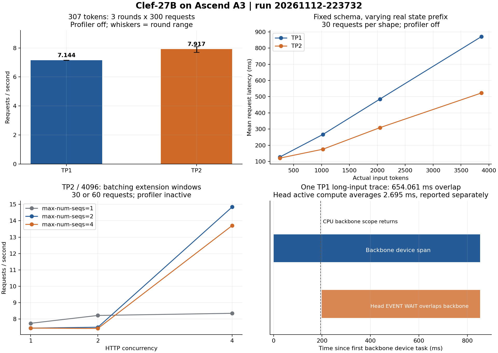

# Clef-27B A3 端到端 profiling 实测报告

本轮于北京时间 2026-11-12 启动、2026-11-13 完成。TP1/TP2 各 900 次固定请求全部成功；14 个采集窗口、24 份 rank trace 通过完整性检查。主干占据主要设备计算，联合头有效计算约 2–3 ms；TP2 短输入的缩放同时受到细粒度下发、归约启动和同步等待影响。TP2/4096 原服务已按原 argv/cwd 恢复，API PID `115206`，健康、协议、重新编码、参考精度和多模态均通过。

后续分析：[2026-11-13 调优建议与最小实验顺序](tuning-review-2026-11-13.md)，补充双 TP1 副本、BF16 NZ 格式、GDN 布局转换及 batching token 预算的验证方案。

远端实验目录：`/workspace/yangchen/logs/profiling/20261112-223732-systemone/`。24 个原始 `_ascend_pt` 目录及现有导出合计 **5,890,605,633 bytes**，保留远端；仓库保存摘要、源文件 SHA、原始数据索引和复现工具。[运行总 manifest](evidence/profiling-20261112/run-manifest.json) · [完整文件 SHA 索引](evidence/profiling-20261112/raw-file-index.json) · [90 份测量汇总](evidence/profiling-20261112/run-summary.json) · [统一性能矩阵 CSV](evidence/profiling-20261112/all-performance-matrix.csv)



## 1. 同条件 TP1 / TP2 正式结果

两组使用相同四个现有应用补丁、BF16、eager、pooling、max model len 1024、max-num-seqs=1、max-num-batched-tokens=1024、memory utilization=0.90，image=1/video=0，processor 参数一致，prefix caching/chunked prefill 关闭。请求为默认 `joint` 的 mixed 三字段、候选 2/2/3、固定 **307 tokens**，精确 POST SHA-256 为 `ab2724637a36029759ea673964b59f0c30fc2e27af4b7d7fa3bdcd784de33aef`。

每轮独立预热 10 次、正式 300 次、HTTP 并发峰值 1；三轮测量窗口均超过 30 秒。正式服务关闭 profiler 与全部观测变量。

| 指标 | TP1/1024 | TP2/1024 |
| --- | ---: | ---: |
| 三轮 requests/s | 7.141744 / 7.140280 / 7.149893 | 7.683093 / 8.078748 / 8.001898 |
| 三轮窗口，秒 | 42.0065 / 42.0152 / 41.9587 | 39.0468 / 37.1345 / 37.4911 |
| 合并吞吐，requests/s | **7.143970** | **7.917493** |
| decisions/s | 21.431909 | 23.752479 |
| input tokens/s | 2193.198653 | 2430.670305 |
| 成功 / 样本 | 900/900，100% | 900/900，100% |
| p50 / p95，ms | 139.894 / 140.353 | 124.836 / 135.346 |
| p99，ms；样本量 | 141.591；900 | 139.423；900 |
| 均值 / 样本标准差，ms | 139.942 / 0.416 | 126.248 / 4.521 |
| 三轮 requests/s 的 CV | 0.0725% | 2.6485% |

本轮 TP2 合并吞吐提高 **10.83%**。分位数统一使用 `(n−1)×q` 的线性插值；合并分位数来自 900 条实际请求，吞吐为成功数除以三轮窗口总时长。历史 30 次、约 4 秒窗口继续保留其原条件，本轮结果由三轮长窗口独立建立。[逐轮 CSV](evidence/profiling-20261112/performance-matrix.csv) · [稳定性摘要](evidence/profiling-20261112/stable-summary.json)

延迟保持原定义，包含 HTTP、UTF-8/JSON 解码及协议校验。客户端一次提交 300 个 future，线程池排队单独记录：TP1/TP2 平均约 20.933/18.780 秒，实际 HTTP 同时发送仍为 1。该排队对应客户端提交策略。[测量脚本](../scripts/benchmark_systemone.py)

## 2. 现场、源码与恢复证据

| 项目 | 本轮实际记录 |
| --- | --- |
| 设备 | 两个 Ascend910_9382，各 65536 MiB；逻辑 0/1 → 物理 14/15，card 7 |
| 容器 | Ubuntu 22.04.5/aarch64；cgroup v1 配额 32 核等价、128 GiB；可见 CPU 0–639 |
| 软件 | CANN/A3 Ops 9.2.1、ATB 9.2.1.B020、driver/npu-smi 26.1.1；Python 3.12.16、torch 2.10.0+cpu、torch_npu 2.10.0.post7 |
| profiler | TorchNPU 2.10.0.post7；msprof package metadata 26.2.0；`msprof --version` 的退出和 help 输出单独保留 |
| vLLM | `24420b7a341af37a9bc3186e6fc6062512e0aa58` |
| vLLM-Ascend | `89eb8a5e7a76d085b453a1aeadb6883e12d5ea2d` |
| 性能环境 | OMP_NUM_THREADS=1、TASK_QUEUE_ENABLE=1；设备可见性、加载路径、freeze/check、CANN/驱动与磁盘均保存 |
| 工程来源 | 本地起始 HEAD `869a442`；现场原工程 HEAD `3e83ae1`，包含既有未提交 baseline |
| 工具 checkout | `/workspace/yangchen/work/profiling-checkout-20261112`，从 `59868d1` 建立；后续工具按实际 SHA 保存 |
| 工具发布 | 解析/复现代码提交 `f07d994`；收尾后清洁复现 checkout 为 `/workspace/yangchen/work/profiling-tools-20261113` |
| 应用补丁 | numpy126、加载审计、TP embedding、flash-attn 构建并发四份，沿用安装记录和逐文件 SHA |

保留了原工程工作区，现场源文件、diff、补丁和模型 manifest 哈希已存档。实验前后 **原工程、vLLM、vLLM-Ascend 的 diff SHA 完全一致**，全部观测补丁已恢复，临时 helper 已移除。恢复后的五组答案与 usage 和实验前逐项完全一致。

[安装与四补丁](installation-2026-11-12.md) · [实验前快照](evidence/profiling-20261112/inventory-before.json) · [实验后快照](evidence/profiling-20261112/inventory-after.json) · [环境/配额与内存补查](evidence/profiling-20261112/memory-startup.json) · [控制器版本](evidence/profiling-20261112/controllers.json) · [恢复校验](evidence/profiling-20261112/restoration.json)

当前日志为 `$run/restored-tp2-4096/service.log`，服务指针为 `$run/service-current.json`。既有 PID 文件 `/workspace/yangchen/logs/clef-tp2-4096-mm-20261112.pid` 已更新到 `115206`。原日志保留历史采集时间。[当前服务](evidence/profiling-20261112/service-current.json)

## 3. HTTP、CPU、排队与引擎时间

下表来自 **关闭采集** 的真实测量。客户端为 900 个正式样本；原生服务指标来自每轮 before/after 差分，各 310 次，合计 930 次，包含 30 次预热。六对计数、model/engine labels、created 和时间边界均通过校验。

| 均值，ms | TP1 | TP2 | 统计范围 |
| --- | ---: | ---: | --- |
| 客户端完整请求 | 139.942 | 126.248 | 900 正式请求 |
| 客户端 HTTP | 139.865 | 126.142 | 包含网络、服务队列、执行、序列化 |
| 客户端 JSON 解码 | 0.027831 | 0.038320 | UTF-8 与 JSON |
| 客户端协议校验 | 0.028664 | 0.035765 | benchmark 校验 |
| 原生服务队列 | 0.006588 | 0.006033 | 930 次，QUEUED → SCHEDULED |
| 原生 RUNNING | 136.503 | 122.418 | 930 次，包含执行及完成等待 |
| 原生引擎 e2e | 137.128 | 123.068 | 930 次原生 stats |
| 引擎 e2e 扣 queue/RUNNING 的残余 | 0.618278 | 0.643839 | 包含调度、IPC 和收尾 |

HTTP、引擎 e2e、RUNNING 为包含关系。930 与 900 的差分范围分别保留，差值用于检查时间规模，独立前端归因使用下面的受控 CPU 计时。[原生服务阶段及源码定义](evidence/profiling-20261112/server-phases.json) · [逐请求观测表 TP1](evidence/profiling-20261112/cpu-decomposition-tp1.csv) · [TP2](evidence/profiling-20261112/cpu-decomposition-tp2.csv)

独立新进程清除全部观测变量，使用同一真实 ModelConfig/tokenizer/strategy，排除加载、读文件、等值校验和日志；每 shape 每组预热 10、正式 100 次。1,400 次正式编码的 IDs/schema/orders 与已保存证据完全一致。state 的 770 次调用均绕过缓存，state cache entries=0。

| 输入 | 原始 encode，ms | 仅缓存 schema token，ms | 实测 CPU 节省，ms |
| --- | ---: | ---: | ---: |
| 固定 307 | 1.066 | 0.103 | 0.963 |
| 1 字段 | 0.671 | 0.082 | 0.589 |
| 8 字段 | 4.902 | 0.277 | 4.625 |
| 2 候选 | 0.405 | 0.068 | 0.337 |
| 16 候选 | 1.809 | 0.137 | 1.673 |
| 3868 tokens | 7.869 | 7.279 | 0.589 |

带逐调用日志的 schema wall 时间可到 5.8/25.4 ms；收益估计采用上述关闭观测的编码结果。此 ablation 在临时对象上执行，服务源码和生产缓存配置保持原状态。[CPU 编码 ablation](evidence/profiling-20261112/cpu-encoding-ablation.json)

## 4. 主干、联合头与通信分解

原生短窗口为 CPU+NPU、Level1、PipeUtilization；另以小补丁显式转发 record_shapes/with_flops，按需开启 profile_memory/with_modules、CPU record_function 与 request-ID 日志。底层 with_stack=false，torch schedule 保持固定 wrapper 的行为。每个新 shape 先在采集外预热。

原生采集平均延迟 TP1 142.519 ms、TP2 176.333 ms，相对各自无采集均值增加 **1.84% / 39.67%**。深采集的内存、shape、module 和日志开销另行记录；例如 TP1 fixed307 深采集 HTTP 为 228.707 ms。因此生产吞吐取第 1 节，trace 提供算子、等待、重叠和请求依赖证据。

以下为 5 个正式请求的 **每请求设备区间均值**。compute 排除 EVENT WAIT/RECORD、通信父范围和 AICPU bookkeeping；communication 含等待且能与计算重叠。

| shape | TP1 backbone compute，ms | TP2 rank0/rank1 backbone compute，ms | TP1 head compute，ms | TP2 rank0/rank1 head compute，ms |
| --- | ---: | ---: | ---: | ---: |
| 固定 307 | 129.389 | 81.234 / 81.668 | 1.951 | 1.976 / 1.962 |
| 长输入 3868 | 851.620 | 452.124 / 453.322 | 2.695 | 2.713 / 2.729 |
| 八字段，1209 tokens | 306.583 | 175.532 / 176.412 | 2.625 | 2.631 / 2.674 |

主干包括 48 层 Gated DeltaNet、16 层 full attention，以及 MLP、RMSNorm、RoPE、搬运/格式转换。native TP1 的 MLP 升/降维 MatMul 累计 **312.353 ms/5 请求**，占设备 kernel union 654.347 ms 的 **47.7%**；TP2 rank0 对应约 160.788 ms，接近 1.95 倍缩短。GDN 对应 69.736 → 53.990 ms，仅约 1.29 倍缩短。每请求约 2.3k–2.6k 个设备 task，计算、同步和通信各自统计。

联合头的 MultiheadAttention、TransformerDecoderLayer、FFN、LayerNorm、softmax 属于 joint_head 范围，完整 active 计算约 2–3 ms。候选 embedding compute 在 TP2 为约 0.05–0.10 ms，加上独立归约和等待。字段/候选循环位于 CPU schema 构造与响应重排，pooler 按 prompt 处理，head 按固定模块层执行。

精确按 joint_head 的 CPU flow→设备 Task/Stream key 提取每 rank 1,255 个 CSV kernel（5 请求），得到 TP1/TP2 rank0/rank1 的每请求 1.949/1.974/1.961 ms。MatMul/linear 约 0.700/0.706/0.702 ms，attention kernel 约 0.487/0.486/0.490 ms，LayerNorm 约 0.162/0.166/0.164 ms，softmax 约 0.041 ms。算子族保留原始 shape/dtype 与 CSV/flow 坐标；MHA、TransformerDecoder、FFN 的内部边界保持未单独标记。[联合头算子表](evidence/profiling-20261112/joint-head-operations.csv) · [覆盖校验](evidence/profiling-20261112/joint-head-operations.json)

实际结果路径先执行异步 `output.to('cpu', non_blocking=True)`，`get_output()` 等待 copy event 完成，strategy 的 `data.tolist()` 处理 CPU 数据。head 内后端 item/local_scalar 为微秒量级，父子事件独立列出。[源码/搬运/同步审计](evidence/profiling-20261112/transfer-sync.json)

**关键链证据：**TP1 long 首个请求的 head-labelled EVENT WAIT 持续 654.887 ms，其中 **654.061 ms 与主干 GPU 范围重叠**。主干 CPU scope 已返回，GPU 仍执行；head active 均值为 2.695 ms。该等待属于上游完成依赖，图中两条区间具有重叠。对应 trace `event_index=200450`、stream 44、backbone scope 14521、`cpu-95805.jsonl:14199`，请求 ID 保存在摘要中。

[TP1 fixed](evidence/profiling-20261112/observed-tp1-fixed307.json) · [TP1 long](evidence/profiling-20261112/observed-tp1-long3868.json) · [TP1 fields8](evidence/profiling-20261112/observed-tp1-fields8.json) · [TP2 fixed](evidence/profiling-20261112/observed-tp2-fixed307.json) · [TP2 long](evidence/profiling-20261112/observed-tp2-controlled-length-4032.json) · [TP2 fields8](evidence/profiling-20261112/observed-tp2-fields-8.json)

### Top20 与硬件补证

[Top20 CSV](evidence/profiling-20261112/top20.csv)包含 native 与深采集、每 rank 的前 20 项，共 120 行：模块/算子、shape/dtype、调用数、累计/平均、区间 union、active-only unique coverage、设备时间可消除上界、CSV 行/flow 坐标及 pipe 指标。完整逐调用数组保留远端 `operations.csv` / `module_instances.csv` / `request_device_windows.csv`。

`critical_path_contribution_us` 保留 unknown；设备时间上界与 active-only 独占覆盖用于约束候选收益，host/跨 stream 的关键链由请求 flow 和同步区间单独说明。父子模块、通信范围/AICPU task、kernel 累计与 union 均保留各自口径。

Top1 MLP 的 native 签名为 BF16、ND/ND、`307×5120` 与 `34816×5120`、输出 `307×34816`、24 blocks；aic_mte2_ratio≈0.994、aic_mac_ratio≈0.521，cube_utilization 字段约 98.83%，各字段按其导出语义记录。停止模型后，使用普通 msprof 分别采 Memory/MemoryL0/L2Cache，三组有效采集均完成；每组同进程单权重与三权重轮换各 10 预热、16 正式，kernel 签名与 native 一致，平均约 **601/604 μs**。

已确认 MTE2 数据搬运占用高。微复现采用 contiguous 输入/权重，原位 physical stride 与完整模型缓存状态保留边界；HBM 峰值带宽饱和度继续等待经校准的计数器解释。首次 msprof 解释器路径失败和成功 launcher 重试均有日志。[MLP 微复现与原始索引](evidence/profiling-20261112/micro-mlp.json)

### TP2 通信

固定 307 请求每 rank **130 次 all_reduce/request**：64 层各两次、主干词嵌入一次、候选 lexical embedding 一次。650 次/5 请求中，645 次报告 3,143,680 B，5 次报告 921,600 B，分别与 `307×5120×BF16`、`90×5120×BF16` 对应。

native rank0 的 communication elapsed/wait 累计约 407.159/392.297 ms，rank1 为 69.278/34.755 ms；单一 SIO 通道净 transit 累计约 14.45 ms/5 请求。等待与净搬运分别列出，两个 rank 对齐分析保存公共时钟依据和每调用开始偏移。深采集中的等待倾斜方向会变化，数据用于定位下发/同步位置，生产收益由关闭采集的 batching A/B 约束。

## 5. 长度、字段、候选与多模态

TP1/TP2 各 20 个样本、每样本 10 预热和 30 正式；**1,200/1,200 正式请求通过**，实际 API token 数与完整离线编码对应，截断为 0。自然原始输入为 256/1024/2000/4032 tokens；控制长度组固定 schema 和候选，取真实 state 的前缀，实际为 256/1024/2048/3868。

| 控制长度 tokens | TP1 平均 ms / rps | TP2 平均 ms / rps |
| --- | ---: | ---: |
| 256 | 127.634 / 7.832 | 120.752 / 8.277 |
| 1024 | 266.399 / 3.753 | 175.395 / 5.698 |
| 2048 | 485.442 / 2.060 | 308.773 / 3.238 |
| 3868 | 871.441 / 1.147 | 523.015 / 1.912 |

3868 tokens 下 TP2 约快 **1.67 倍**。TP1 的自然 4032-token 输入也完整执行，显存范围已实际验证。

| 固定 state 扫描 | 实际总 tokens | TP1 平均 ms | TP2 平均 ms |
| --- | --- | --- | --- |
| 字段 1/2/4/8 | 215/357/641/1209 | 128.327/145.159/199.633/322.407 | 119.935/130.874/133.582/210.295 |
| 候选 2/4/8/16 | 162/208/289/491 | 120.363/122.859/136.120/170.148 | 120.085/120.561/120.981/124.055 |

字段与候选增加也增加 schema tokens；独立 head compute 见第 4 节。每个样本保留来源、revision、完整 IDs/schema/span/候选映射、媒体处理结果和输入 SHA。[TP1 矩阵](evidence/profiling-20261112/matrix-tp1-4096.json) · [TP2 矩阵](evidence/profiling-20261112/matrix-tp2-4096.json)

多模态为两张 256×256 图片、两段 96×96、2 帧/2 fps 视频，固定 processor；总 token 为 203/203/173/173，视觉 token 为 64/64/9/9。热缓存未采集窗口：红图平均 TP1/TP2 为 147.579/133.467 ms，红蓝视频为 124.268/126.585 ms。

热窗口每 rank 的 vision_encoder 只在首次预热出现。冷窗口额外生成 10 个唯一像素暖场与 5 个未见过的采集输入，保持尺寸、帧数和处理器，每个素材仅一个像素通道有标签。解码内容 hash 全部唯一、暖场/采集无交集，**两 rank 各确认 5/5 正式视觉编码**，全部 30 个暖场/采集请求 token 与语义均通过。

| 冷路径深采集 | CPU 解码 ms | rank0/rank1 vision compute ms | rank0/rank1 vision span ms |
| --- | ---: | ---: | ---: |
| 图片，203 tokens | 3.767 | 8.507/8.559 | 53.683/53.463 |
| 视频，173 tokens | 4.947 | 7.097/7.011 | 61.297/56.199 |

冷深采集 HTTP 为 315.728/328.570 ms，包含其采集开销；热缓存正式窗口与冷 trace 分开记录。[冷图](evidence/profiling-20261112/observed-tp2-cold-image.json) · [冷视频](evidence/profiling-20261112/observed-tp2-cold-video.json) · [素材/像素证据](evidence/profiling-20261112/uncached-media.json) · [冷输入语义](evidence/profiling-20261112/cold-media-semantics.json)

## 6. 并发与 batching

TP1/TP2 的 max-num-seqs=1 并发 1/2/4 已检查。下面为 TP2/4096 相同 fixed307 的扩展窗口，max-num-batched-tokens=4096、内存预算0.90一致。每种实际 batch 形状在采集外预热；正式窗口 profiler 未激活、观测关闭，样本 30 或 60，属于单轮探索测量。

| max-num-seqs | HTTP 并发 | rps | 正式 p50 ms | 实际正式 batch 分布 |
| ---: | ---: | ---: | ---: | --- |
| 1 | 1 | 7.733 | 129.152 | B1 |
| 1 | 2 | 8.213 | 243.013 | B1×60 |
| 1 | 4 | 8.343 | 478.472 | B1×60 |
| 2 | 1 | 7.437 | 133.610 | B1×60 |
| 2 | 2 | 7.493 | 262.905 | B1×60 |
| 2 | 4 | **14.845** | **260.490** | B1×2 + B2×29 |
| 4 | 1 | 7.441 | 135.252 | B1×60 |
| 4 | 2 | 7.417 | 272.039 | B1×60 |
| 4 | 4 | 13.708 | 291.343 | B1×15 + B3×15 |

同并发 4 下，max-num-seqs=2 相对 seqs=1 的吞吐提高 **77.9%**。seqs=4 上限在该窗口实际形成 B1/B3。

正式分布由 Prometheus `iteration_tokens_total` 的 bucket/count/sum 重建：每对增量为 21,490 tokens=70×307，包含 10 个顺序暖场；扣除暖场后恢复 60 个正式请求。created/labels、bucket、总数与加权请求数全部校验。另用独立 20 请求/并发4 native trace 的 MLP-up shape/64层核验 batch 公式，两组人群分别保存。

归约调用从单请求 130 次，推导到 seqs2 正式每请求 **67.65**、seqs4 **65.5**；逻辑 payload 维持 406,456,320 B/request。批处理减少调用启动次数，并提高同一次权重读取服务的 token 数。两配置异构五样本共比较 180 个响应、252 个决策，离散全部一致，概率/score 最大差均在既定判据内。[正式 batch 与 native 核验](evidence/profiling-20261112/batching.json) · [batch CSV](evidence/profiling-20261112/batching.csv)

## 7. 显存

启动统计为 dummy profile 和 warmup；实际请求内存来自短窗口，设备级 HBM 为 `npu-smi` 每秒采样。GiB 使用 2³⁰；profiler CSV 的 `MB` 标签由安装源码确认实际使用 MiB。不同 component 有重叠，PTA 与 PTA+GE 保留各自记录。

| 配置，每 rank | 权重 GiB | KV/Mamba 预算 GiB | warm allocated/reserved GiB | dummy activation / non-torch GiB |
| --- | ---: | ---: | ---: | ---: |
| TP1/1024 | 51.23 | 3.72 | 54.93/54.94 | 0.15/0.04 |
| TP1/4096 | 51.23 | 3.26 | 54.52/54.53 | 0.61/0.04 |
| TP2/1024 | 25.76 | 28.76/28.77 | 54.52/54.54 | 0.12/0.51 |
| TP2/4096 | 25.76 | 28.46/28.47 | 54.25/54.27 | 0.41/0.51 |

真实 backing storage 按 device/pointer/size 去重：TP1/4096 为 **3.25 GiB**、104 blocks；TP2/4096 每 rank **28.453125 GiB**、1821 blocks。两类 spec 共用物理存储，逻辑 view 大小与实际 backing 分列；TP1 有16层 FullAttentionSpec、48层 MambaSpec。接近 60,000 MiB 的设备读数包含权重、预分配池、运行时和设备上下文。

| 实际请求 PTA allocated max−min，MiB | TP1 | TP2，每 rank |
| --- | ---: | ---: |
| 固定307 | 152.452 | 119.479 |
| 长输入3868 | 1057.261 | 647.185 |
| 八字段1209 | 376.129 | 243.683 |
| 冷图片 / 冷视频 | 见 trace | 109.439 / 102.030 |

此包络包含本窗口激活和临时 Torch 分配增量，包含观测影响。当前导出 component 为 APP/PTA/PTA+GE，具名 WORKSPACE 记录缺失，独立 workspace 总峰值保留 **unknown**。严格边界为：PTA 基线之上的临时 workspace 增量受上表包络约束，常驻 baseline workspace 和 PTA 外分配另保留其范围。dummy activation 用于启动预算，真实长请求按实际窗口统计。[11 配置、17 份内存 trace 与原始行号](evidence/profiling-20261112/memory-startup.json)

## 8. 优化候选与最小验证

以下按当前可验证收益及可优化时间规模排序，区分吞吐、延迟和内存目标。条件估算采用已定位区间；实施收益通过关闭采集的同输入 A/B 确认。

| 优先级 / 候选 | 关键路径证据与收益界限 | 成本、精度与下一步 |
| --- | --- | --- |
| 1：并发4配 max-num-seqs=2 | 实测14.845 rps，相同并发的seqs1为8.343，约+77.9%；batch与归约数均有正式指标证据 | 配置成本低；本轮252决策已通过。上线候选再做三轮≥30秒/≥300请求与延迟SLA；seqs4可补并发8、检查实际B4 |
| 2：MLP权重搬运/格式或实现优化 | TP1两类MatMul为62.47ms/request，设备active约47.7%；MTE2高占用与微复现匹配。条件：kernel时间降低20%对应约12.5ms(TP1)/6.4ms(TP2)设备时间规模 | 中高成本；先在相同signature比较ND/NZ或其他受支持实现，复核真实stride与各长度；随后协议、CPU参考及公开样本回归 |
| 3：GDN周边融合与下发优化 | GDN约13.95/10.80ms(request)，TP2缩放约1.29×，每请求数千task；可优化时间上限先以实际关联区间约束 | 中高成本；先提取Top算子及上下游，比较调用数、active/空隙与单卡/双卡结果，保持状态与同步语义 |
| 4：有界schema token缓存 | 无观测CPU ablation已验证，固定请求节省0.963ms、八字段4.625ms；state完全绕过缓存 | 低成本；按tokenizer revision/schema内容建立有界LRU，逐请求核对IDs、span、候选重排，随后API A/B测实际收益 |
| 5：按工作负载缩小缓存池 | TP2每rank预分配28.453GiB；若后续验证4–8GiB池足够，容量收益约20–24GiB/rank | 配置成本低、时延收益另测；先覆盖4096输入、batch4、实际Mamba状态/池耗尽与精度后再调整预算 |
| 6：联合头局部优化 | 整头active仅约2–3ms/request；候选embedding为一次归约，纯compute约0.05–0.10ms | 收益按该时间规模设置；先固定输入/字段/候选做微复现，继续验证probabilities、score与映射 |

已证实：主干/MLP为主要计算成本；细粒度归约/同步限制短输入TP缩放；batching在本轮产生明确吞吐收益；头的长等待与主干重叠；热媒体命中encoder cache；大量HBM用于缓存池。

继续验证：生产环境的精确跨rank等待根因、优化后完整关键路径变化、原位stride与HBM带宽分母、独立workspace总峰值、batching候选的三轮稳定性和SLA。冷视觉也可单独比较受支持的encoder并行模式，当前收益以其独立采集区间为约束。

## 9. 复现与验收入口

原始运行命令、worker/PID、请求体/样本哈希、各rank目录、采集起止、日志、导出与源SHA均位于run manifest或所链接原报告。工具都保留原默认mixed行为，观测补丁按before/after SHA恢复，服务切换只管理已保存的API/子进程。

新实验先建立独立run并保存原服务：

```bash
cd /workspace/yangchen/work/profiling-tools-20261113
source scripts/activate_env.sh
newrun="/workspace/yangchen/logs/profiling/$(TZ=Asia/Shanghai date +%Y%m%d-%H%M%S)-systemone"
mkdir -p "$newrun"
python scripts/snapshot_systemone_profile.py \
  --output-dir "$newrun/before" --save-service-restore "$newrun/restore-service.json"
# 保存协议/参考输出，再以 manage_systemone_profile_service.py 顺序 stop/start。
python scripts/benchmark_systemone.py --warmup 10 --requests 300 \
  --concurrency 1 --min-duration-seconds 30 --sample-hbm --report "$newrun/round-1.json"
```

采集服务先用 `manage_systemone_profile_service.py start --profile` 配置原生profiler；shape/内存使用 `profile_instrumentation.py --apply` 保存补丁，启动时加 `--observations --memory`。采集控制在finally中停采、stop超时600秒，并在普通独立Python进程逐rank解析；随后严格检查NPU kernel/时间线/原始目录。

```bash
python scripts/profile_systemone.py --output-dir "$newrun/window-1" \
  --trace-root "$newrun/service/traces" --expected-ranks 2 --warmup 10 --requests 5
# 冷媒体使用独立 --warmup-sample-file 与 --sample-file；batch窗口可加 --concurrency 4。
```

只读重建本轮摘要：

```bash
run=/workspace/yangchen/logs/profiling/20261112-223732-systemone
python scripts/summarize_systemone_profile_run.py --run-dir "$run" --output-dir "$run/replay-summary"
python scripts/analyze_systemone_batching.py --run-root "$run" --output-dir "$run/replay-batching"
python scripts/summarize_systemone_server_metrics.py --run-dir "$run" --output "$run/replay-server.json"
python scripts/summarize_profile_memory.py --run-dir "$run" --output "$run/replay-memory.json" --supplement
```

逐窗口trace解析使用[分析CLI和源码SHA索引](evidence/profiling-20261112/analyzer-provenance.json)中的精确 `--trace-dir`、`--benchmark-report` 和 `--observations-root`。`compact_systemone_profile.py`可从已有summary再导出小JSON；`render_systemone_profile_report.py`重建本轮报告图。矩阵/编码/冷媒体/MLP的生成及采集脚本均保存在scripts中。

精度沿用既定0.03概率、0.05 score阈值和离散/token/span/映射对应。恢复时再次真实执行编码审计，5/5、7/7通过，概率最大差0.000256002、score最大差0.000324931；MM4/4。现服务与原argv/cwd对应、旧PID文件已更新，观测源码与环境已清理。[重新编码](evidence/profiling-20261112/restored-encoding.json) · [参考精度](evidence/profiling-20261112/restored-precision.json) · [多模态](evidence/profiling-20261112/restored-multimodal.json)

阶段提交与push已按工程约定执行。最终66项本地合同/负向/synthetic检查、Python语法与文档链接检查通过，[最终检查记录](evidence/profiling-20261112/validation-final.json)与硬件证据分别标注范围。早期连接失败与本地synthetic验收保留其原时间和范围：[早期连接](evidence/profiling-preflight-2026-11-12.json)、[本地准备检查](evidence/profiling-local-validation-2026-11-12.json)。
