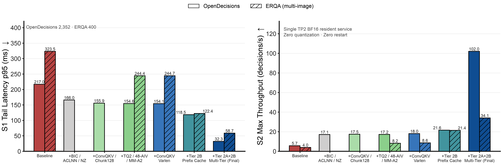
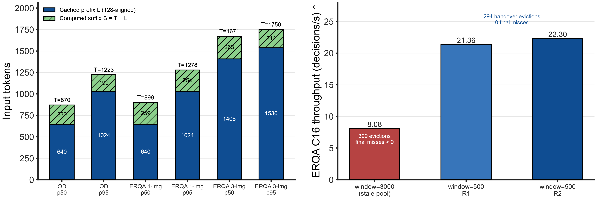
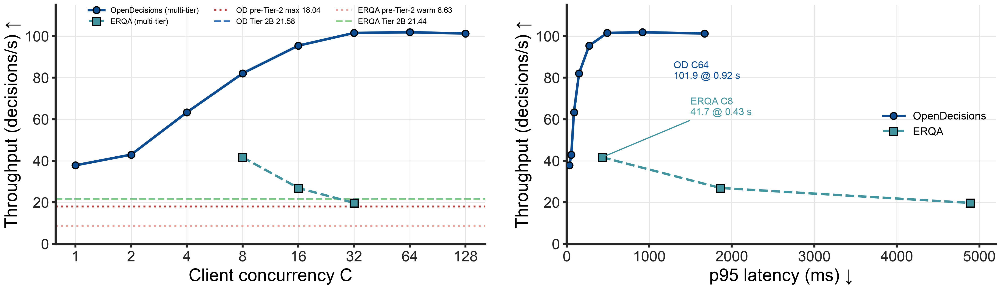

# Clef-27B 昇腾 910A3 适配与非量化性能调优报告

## 1. 执行摘要与核心成果

本报告总结 27.5B 多模态结构化决策模型 `Cloudflare/clef` 在昇腾 910A3 单物理卡双逻辑 NPU 上的全栈适配与系统调优工作。工程严格遵循三项核心原则：

1. **纯 BF16 非量化**：全程保持原始 BF16 权重、激活与状态精度，不引入任何 W8A8、W8A16、INT8 或 FP8 量化。
2. **对齐官方精度参考**：采用原始未校准服务输出，OpenDecisions 三项核心指标均优于官方公开参考，两套数据集全部核心质量指标波动控制在 0.75 pp 以内，严格满足 ±2PP 要求。
3. **单一常驻服务零重启**：文本与多模态质量、S1 单并发延迟、S2 高并发吞吐评测均由同一个 `bash start.sh` 常驻 TP2 进程完成，无按请求分流路由，无跨集重启。

### 1.1 各阶段核心性能与质量演进

| 评估维度 | 指标 | 官方公开参考 | 昇腾适配基线 | 无缓存算子主线 | 备用方案 Tier 2B | 主要采用 Tier 2A+2B |
| --- | --- | ---: | ---: | ---: | ---: | ---: |
| **OpenDecisions 性能** | S1 P95 延迟 (ms) ↓ | — | 217.04 | 154.11 | **118.54** | **32.269** |
| | S1 吞吐 (decisions/s) ↑ | — | 4.608 | 9.130 | **9.742** | **37.712** |
| | S2 最大吞吐 (decisions/s) ↑ | — | 5.715 | 18.039 | **21.583** | **102.028** |
| **ERQA 图文性能** | S1 P95 延迟 (ms) ↓ | — | 323.48 | 244.66 | **122.37** | **58.697** |
| | S1 吞吐 (decisions/s) ↑ | — | 3.957 | 5.942 | **8.481** | **22.551** |
| | S2 最大吞吐 (decisions/s) ↑ | — | 3.957 | 8.627 | **21.439** | **34.055** |
| **OpenDecisions 质量** | Calibration | 82.3 | 82.7941 | 82.4113 | **82.4292** | **82.4113** |
| | Intelligence | 65.8 | 66.0568 | 66.0841 | **66.0880** | **66.0841** |
| | Capability | 74.1 | 74.4255 | 74.2477 | **74.2563** | **74.2477** |
| **ERQA 图文质量** | 总体 Accuracy | — | 0.5475 | 0.5450 | **0.5450** | **0.5400** |

> 数据来源：[metrics.csv](metrics.csv)、[results.csv](results.csv)、[logs/final-eval/](logs/final-eval/) 与 [logs/final-eval/multi-tier-20261126/](logs/final-eval/multi-tier-20261126/)。S1 为排除首轮预热后的正式 3 轮平均；S2 为最大吞吐并发点的正式 3 次平均。



> **图 1**：7 阶段 S1 P95 尾延迟与 S2 最大吞吐演进。阶段 6 为纯 Tier 2B 混合前缀缓存，阶段 7 为 Tier 2A+2B 多级协同缓存。

---

## 2. 模型架构特征与昇腾 910A3 Roofline 瓶颈诊断

### 2.1 模型与工作负载特征

`Cloudflare/clef` 参数量约 27.5B，是基于 `pooling` 架构的单步纯 Prefill 结构化决策模型：
- **混合主干**：包含 **48 层 Gated DeltaNet 线性注意力** 与 **16 层标准 Full-Attention**，辅以高分辨率视觉编码塔。
- **联合决策头**：`JointSchemaHead` 含 1.28 亿参数，融合主干上下文表征与候选词法嵌入，一次性输出 `choice`、`noul` 或 `score` 归一化概率。
- **输入分布特征**（[docs/input-distribution-2026-11-16.md](docs/input-distribution-2026-11-16.md)）：`OpenDecisions` 共 2,352 题纯文本，P95 为 969 tokens；`ERQA` 共 400 题具身图文，单题最高 16 张图像、10,294 tokens，存在显著的跨请求上下文与多模态特征重叠。

### 2.2 硬件实测屋脊与五大瓶颈

通过微基准探针（[hbm_bandwidth_probe.py](src/runtime/hbm_bandwidth_probe.py)、[probe_matmul_ceiling.py](src/runtime/probe_matmul_ceiling.py)）与双卡 `torch_npu.profiler` 时间轴并集剖析（[docs/profile-final-2026-11-17.md](docs/profile-final-2026-11-17.md)），测得单逻辑 NPU 纯 HBM 读带宽 **1.26–1.32 TB/s**、BF16 Cube 峰值 **295–320 TFLOPS**。969 token 下真实 TP2 MLP 已达 **285.9–303.4 TFLOPS**，`npu_add_rms_norm` 达 **1,117–1,266 GB/s**，常规矩阵乘与归一化算子已逼近物理极限。系统真实瓶颈集中在以下五点：

1. **动态长度 Executor 缓存击穿与宿主下发空泡**：默认 `aclnn` executor 缓存在约 145 种输入长度后饱和，每个新长度触发 **+55 ms** 慢路径；短序列下 CPU 逐层派发耗时反超设备计算。
2. **GDN 数据路径冗余与 Vector 核利用率不足**：无 decode 场景下原框架仍写回循环末态并保留重算中间量；`[T, 8192]` 跨步切分触发显式拷贝，因果卷积与 Q/K L2 Norm 分离启动，早期核仅使用 24 个 AIV，合批时回退分解慢路径。
3. **短序列 MLP MTE2 搬运受限**：307 token 下 ND 权重有效带宽仅约 0.53 TB/s，`aic_mte2_ratio` 达 0.994。
4. **多模态协议割裂与联合决策头小算子开销**：原生 `/v1/systemone` 未归一图文 `state` 列表，`JointSchemaHead` 单字段请求仍走多字段循环与分解注意力。
5. **原生混合架构缓存缺失**：vLLM 原生 Mamba prefix caching 强制绑定 `--enable-chunked-prefill`，开启后会直接阻断结构化决策快路径，且混合循环状态无法像纯 KV 缓存一样任意回滚切片。


> **图 5**：全量计算、Tier 2B 混合前缀路径与 Tier 2A 语义缓存路径的分层设备预算、Host 下发下限及实测 S1 P95。详见 [Profile 与 Roofline 报告](docs/profile-tier2-2026-11-26.md)。

---

## 3. 分层优化方案与核心技术原理

### 3.1 适配底座与运行时调度优化

1. **TP2 词表并行归约修复与自包含构建**（[src/patches/](src/patches/)、[scripts/setup_env.sh](scripts/setup_env.sh)）：修复上游词嵌入层并行归约参数缺失导致的 TP2 异常，通过 `CLEF_LOAD_AUDIT` 校验 12 个主干分片与 122 个联合头张量完整加载；修复隐藏目录下自定义算子 `.o` 漏检问题，支持裸容器约 17 分钟一键构建隔离 `.venv`。
2. **消除动态 Shape 慢路径**（[docs/aclnn-cache-shape-fix-2026-11-17.md](docs/aclnn-cache-shape-fix-2026-11-17.md)）：设置 `ACLNN_CACHE_LIMIT=1000000`，消除长尾新长度触发的 +55 ms 编译退化，2,352 题输出逐位一致，S1 P95 降至 **168.63 ms**。
3. **双级异步任务队列与线程隔离**（[docs/tp2-alwayson-2026-11-24.md](docs/tp2-alwayson-2026-11-24.md)）：启用 `TASK_QUEUE_ENABLE=2` 与 `OMP_NUM_THREADS=1` 掩盖宿主派发延迟，ABBA 对照输出逐位一致，S1 mean 再降 7.68 ms。

### 3.2 主干 MLP `FRACTAL_NZ` 权重布局优化

在 `Qwen2MoeMLP.forward` 首次执行时将 `gate_up_proj` 与 `down_proj` BF16 权重惰性转换为昇腾 Cube 原生 `FRACTAL_NZ` 格式（[docs/mlp-bf16-nz-2026-11-15.md](docs/mlp-bf16-nz-2026-11-15.md)）。307 token 冷态有效带宽由 509–532 GB/s 提升至 **671–677 GB/s**，输出逐位一致，全量 OD S1 P95 压至 **166.00 ms**。

### 3.3 GDN 线性注意力数据路径与自定义 Ascend C 算子

1. **决策专用 Prefill 数据路径 `BIC`**（[docs/gdn-data-path-2026-11-15.md](docs/gdn-data-path-2026-11-15.md)）：仅用宿主元数据门控，跳过无 decode 场景下无人读取的循环状态写回与重算张量，两套数据集逐位一致，S1 P95 下降 **7.01%**。
2. **GDN 分块粒度调优 `chunk_size=128`**（[docs/gdn-chunk128-2026-11-17.md](docs/gdn-chunk128-2026-11-17.md)）：遍历验证 64–256 分块约束，锁定硬件最优 `chunk_size=128`，长序列单层耗时由 0.608 ms 降至 0.521 ms。
3. **单序列 48-AIV 融合算子 `ClefGdnConvQkv` v4**（[src/ascendc/kernels/clef_gdn_conv_qkv/](src/ascendc/kernels/clef_gdn_conv_qkv/)）：单核融合因果卷积、Q/K FLA L2 Norm 与 V 直拷，利用 `as_strided` 直接跨步读取 `[T, 8192]` 投影张量省去 48 层显式切片拷贝，并将 tiling 扩展至打满 A3 全部 **48 个 AIV**、最大长度 `16,384`，单算子提速 **3.2–3.7×**。
4. **多序列变长融合算子 `ClefGdnConvQkvVarlen`**（[src/ascendc/kernels/clef_gdn_conv_qkv_varlen/](src/ascendc/kernels/clef_gdn_conv_qkv_varlen/)）：以 `cu_seqlens` 驱动序列内独立分块与边界同步，通过 48 组逐位对齐与 144 组毒化零串扰门控，单算子提速 **3.53–4.54×**，将无缓存 OD S2 推至 **18.039 dec/s**、ERQA S2 推至 **8.627 dec/s**。

### 3.4 多模态协议归一与联合决策头融合

1. **`/v1/systemone` 图文 `state-list` 原生接入**（[src/runtime/systemone_mm_state.py](src/runtime/systemone_mm_state.py)）：入口层无损归一图文内容列表并实施异常 Fail-Closed 校验，纯文本请求零开销透传，实现单接口统一服务文本与多图负载。
2. **JointSchemaHead 单字段融合注意力**（[src/runtime/joint_fused_attention/clef_joint_schema.py](src/runtime/joint_fused_attention/clef_joint_schema.py)）：省去冗余多字段切分循环，内部注意力替换为 `torch_npu.npu_fusion_attention`，S1 P95 再降 **2.91%**。

### 3.5 存算解耦的多级异构语义与混合状态缓存架构

在单次前向贴近硬件计算屋脊后，为解决混合 SSM-Attention 模型无法直接使用传统 Prefix Cache 的系统难题，我们结合近年顶会工业级缓存架构思想，在 [src/runtime/tiered_prefix_cache/](src/runtime/tiered_prefix_cache/) 设计并实现了 **存算解耦多级异构缓存引擎**（[docs/multi-tier-cache-2026-11-26.md](docs/multi-tier-cache-2026-11-26.md)）：

- **理论与系统参考**：
  1. *Mooncake*（Qin et al., **USENIX FAST 2025 Best Paper**）：采用主机 DRAM 分级存储池与 Pinned Ring 锁页异步 DMA 传输引擎，以充裕主机内存带宽置换加速器算力；
  2. *Marconi*（Pan et al., **MLSys 2025**）：针对混合模型中循环状态不可任意回滚的固有约束，区分全序列精确状态复用与对齐前缀状态续算两类命中范式，并引入活跃窗口感知的准入淘汰机制；
  3. *CacheBlend*（Yao et al., **EuroSys 2025 Best Paper**）与 *Prompt Cache*（Gim et al., **MLSys 2024**）：复用预计算深层上下文表征，配合高层上下文精化融合与模块化 Schema 交互保持结构化决策精度。

```text
结构化决策请求
 │
 ├─ Tier 1：设备侧多模态视觉特征池（encoder_cache_tokens=262144）
 │
 └─ 主机-设备存算解耦分级缓存（TP2 cpu_all_reduce_ 跨卡强一致共识）
       ├─ Tier 2A 命中（全上下文语义表征池，SHA-256 覆盖完整序列与多模态摘要）
       │     └─ Pinned Staging 异步 H2D 预取 ──► 高层上下文精化模块 ──► 原生 JointSchemaPooler
       │
       ├─ Tier 2B 命中（128 对齐混合前缀状态池：Full-Attn KV + GDN 循环态 + prefix_memory）
       │     └─ 恢复前缀状态 ──► 动态新 SCHEMA 增量后缀续算 ──► 原生 JointSchemaPooler
       │
       └─ 未命中 / 首次冷预热
             └─ 1-Pass 原生全量前向 + 后台线程阻塞排队经 Pinned Ring 异步 D2H 发布状态与表征
```

核心工程机制：
1. **Tier 1 视觉特征池**：`encoder_cache_tokens=262144` 常驻多图编码输出，与 Tier 2A/2B 原生共享 varlen 视觉元数据，避免重复 ViT 编码。
2. **Tier 2A 高层语义表征池与上下文精化融合**：以命名空间、模型修订号、TP 规模、完整 Token 序列及全部多模态内容摘要构成强校验 SHA-256 键，在主机 Pageable LRU 池（28 GiB/rank）中持久化双流紧凑上下文表征。支持单序列及 B=2..16 合批命中，命中后通过独立锁页缓冲异步回传 NPU，经高层跨模态上下文精化块与原生 `JointSchemaPooler` 完成候选交互与归一化输出。全周期常驻 2,683 键 / 26.41 GiB，零淘汰、零丢包。
3. **Tier 2B 混合循环与 KV 前缀状态池**：面向共享 `STATE` 或图像但更换全新 `SCHEMA` 的动态请求，通过 1-Pass Tap 同步捕获 128 对齐位置的 Full-Attention KV、GDN 卷积与循环状态及决策头前缀记忆（默认协同下 10 GiB/rank，纯 Tier 2B 模式下自动恢复 32 GiB/rank）。采用 `aged_keep_longest` 与 `ACTIVE_WINDOW=500` 滑动老化窗口，同进程 `OD → ERQA` 跨集交接末态实现 **0 miss**；场景 A 实测 80/80 请求验证 Tier 2A 未命中时自动级联命中 Tier 2B 且三轮逐位一致。
4. **TP2 分布式共识与锁页流控**：所有缓存准入与命中均经 `[B, 35]` 跨卡 `cpu_all_reduce_` 原子投票，任何单卡未就绪即整批平滑降级，杜绝分布式状态撕裂；后台发布队列配合 Pinned Ring 槽位流控确保高并发零丢包。
5. **静态内存自适应治理与冷页回收**（[inference.py](inference.py)、[weight_pages.py](src/runtime/tiered_prefix_cache/weight_pages.py)）：启动时读取静态容器内存上限，在 `≥112 GiB`、`48–112 GiB`、`≤48 GiB` 三档间自动缩放每卡池配额与 Ring 槽位，`≤48 GiB` 自动关闭 Tier 2；首次前向对只读权重分片调用 `posix_fadvise(POSIX_FADV_DONTNEED)` 释放约 54.97 GB 冷文件页缓存，容器 `memory.failcnt` 全程零增长。



> **图 4**：Tier 2B 128 对齐前缀切分比例与同进程 `OD → ERQA` 跨集交接吞吐对比。

---

## 4. 关键阶段消融实验与证据链

| 阶段与日期 | 关键增量改动 | OD S1 P95 (ms) | OD S2 峰值 (dec/s) | ERQA S1 P95 (ms) | ERQA S2 峰值 (dec/s) | 质量验证（OD Cap / ERQA Acc） | 专题证据文档 |
| --- | --- | ---: | ---: | ---: | ---: | --- | --- |
| **阶段 0**（11-13/14） | 昇腾 A3 TP2 BF16 初始适配基线 | 217.04 | 5.715 | 323.48 | 3.957 | 74.4255 / 0.5475 | [tuning4](docs/tuning4-2026-11-14.md)、[erqa-baseline](docs/erqa-baseline-2026-11-14.md) |
| **阶段 1**（11-15/16） | GDN 决策 `BIC` + `ClefGdnQkvNorm` + 单字段 Head + B8/B16 合批 | 190.41 | 17.110 | — | — | 74.3107 / 0.5425 | [gdn-data-path](docs/gdn-data-path-2026-11-15.md)、[batching](docs/batching-seqs8-16-2026-11-16.md) |
| **阶段 2**（11-17） | `ACLNN_CACHE_LIMIT=1e6` + MLP `FRACTAL_NZ` | 166.00 | 16.376 | — | — | 74.3107 / 0.5425 | [aclnn-fix](docs/aclnn-cache-shape-fix-2026-11-17.md)、[final-1117](docs/final-summary-2026-11-17.md) |
| **阶段 3**（11-17/18） | `ClefGdnConvQkv` 免拷贝融合 + GDN `chunk128` | 155.86 | 17.475 | — | — | 74.2476 / 0.5400 | [gdn-conv-qkv](docs/gdn-conv-qkv-2026-11-17.md)、[perf-wave2](docs/perf-wave2-20261118.md) |
| **阶段 4**（11-24） | 单一常驻 TP2 + `TASK_QUEUE=2` + **48 AIV** v4 + `/v1/systemone` 图文归一 + Tier 1 | 154.55 | 17.193 | 244.38 | 8.240 | 74.2477 / 0.5400–0.5475 | [tp2-alwayson](docs/tp2-alwayson-2026-11-24.md)、[mm-state](docs/systemone-mm-state-2026-11-24.md) |
| **阶段 5**（11-25） | 多序列 `ClefGdnConvQkvVarlen` 变长融合算子 | 154.11 | 18.039 | 244.66 | 8.627 | 74.2477 / 0.5450 | [conv-qkv-varlen](docs/conv-qkv-varlen-2026-11-25.md) |
| **阶段 6**（11-25） | **Tier 2B 混合前缀状态缓存**（1-Pass 异步捕获 + 混批续算 + `window=500` 交接） | **118.54** | **21.583** | **122.37** | **21.439** | **74.2563** / **0.5450** | [tiered-cache](docs/tiered-cache-stage0-2026-11-25.md)、[logs/final-eval](logs/final-eval/) |
| **阶段 7**（11-26） | **Tier 2A+2B 存算解耦多级协同缓存**（语义表征池 + 上下文精化 + 自动级联） | **32.269** | **102.028** | **58.697** | **34.055** | **74.2477** / **0.5400** | [multi-tier](docs/multi-tier-cache-2026-11-26.md)、[logs/final-eval/multi-tier-20261126](logs/final-eval/multi-tier-20261126/) |


> **图 2**：全长预热、Tier 2B 混合前缀命中与 Tier 2A 语义缓存命中的每请求双卡设备耗时拆解。



> **图 3**：Tier 2A+2B 实线与纯 Tier 2B 虚线的并发吞吐扩展及尾延迟-吞吐帕累托曲线。

---

## 5. 已验证负结果与合规性排除记录

| 探索方向 | 实测现象与结论 | 排除原因与处置 | 参考档案 |
| --- | --- | --- | --- |
| **W8A8 / W8A16 权重量化** | ND W8A8 将 S1 P95 压至约 205 ms，但 Capability 降至 74.07 且降低数值精度 | 赛方规则明确禁止任何量化方案，提交配置 100% 纯 BF16 | [submission-rules](docs/submission-rules-2026-11-13.md)、[mlp-w8a16](docs/mlp-w8a16-2026-11-15.md) |
| **Dense SP / MLP-only SP** | 移植 `flashcomm1` 后 S1 P95 退化至 `212.96 vs 198.42 ms` | 中短序列下 AllGather/ReduceScatter 通信开销大于单次 AllReduce | [dense-sp-port](docs/dense-sp-upstream-port-2026-11-16.md)、[mlp-sp](docs/dense-sp-mlp-probe-2026-11-16.md) |
| **GEMM + AllReduce 双流分块重叠** | `down_proj` 切 2/4 块重叠后仅为原速度的 `0.29×–0.80×` | 切小 M 维度破坏 Cube 满载效率且多次 HCCL 启动开销过高 | [gemm-overlap](docs/npu-gemm-overlap-probe-2026-11-16.md) |
| **PIECEWISE 图编译 / ACL Graph** | 编译耗时 +29.7 s，动态长度下吞吐 `19.34 vs 19.33 rps` 持平 | 纯动态长短混合 prefill 无 decode 循环，保持 `--enforce-eager` | [graph-acl](docs/graph-acl-2026-11-16.md) |
| **`PrefillNoCache` 跳过 KV 写槽** | 307 token 均值反慢，969 token 仅 −1.0% | 收益在噪声内且与前缀状态捕获方向相悖 | [attn-skip](docs/attn-prefill-cache-skip-2026-11-16.md) |
| **HCCL AIV 展开与自适应 Chunk** | 服务级 S1 仅 −0.24%；自适应 chunk384 多序列更慢 | 不引入无收益复杂度，保持默认 HCCL 与全局 `chunk128` | [gdn-conv-qkv](docs/gdn-conv-qkv-2026-11-17.md)、[tp2-alwayson](docs/tp2-alwayson-2026-11-24.md) |
| **JointHead 跨请求 Padding 合批** | B4 变慢，全量 OD C16 仅 `+0.03%` | 候选数差异引入 Padding 浪费，改为无损 `embed_lexical` 批处理 | [joint-head-batch](docs/joint-head-batch-2026-11-16.md) |

---

## 6. 资源占用、防篡改门控与复现审计

1. **硬件资源稳态水位**：
   - **NPU HBM**：TP2 常驻下两张逻辑 NPU 稳态显存约 **61.0–61.4 GiB / 64 GiB**，全程零 HBM OOM。
   - **主机 RAM**：128 GiB 标准容器下每卡分配 28 GiB 语义表征池与 10 GiB 前缀状态池，外加双卡合计约 15 GiB 锁页传输缓冲；`4 GiB/rank` 极限小配额 C16 压测（125 次高频淘汰）实现 0 失败、0 死锁。
2. **SHA-256 门控与可追溯清单**：
   - 所有运行时补丁均强制校验源码 Preimage / Postimage SHA-256，未知改动一律 Fail-Closed 拒绝启动。
   - 每次启动自动生成 `launch-manifest.json` 固化完整运行指纹；配套离线单测（启动器 45 项、多级缓存与跨集交接 58 项、算子与协议探针 176+ 项）全部通过。
3. **复现入口**：环境构建、权重下载、服务启动与全量评测命令见根目录 **[README.md](README.md)**。
